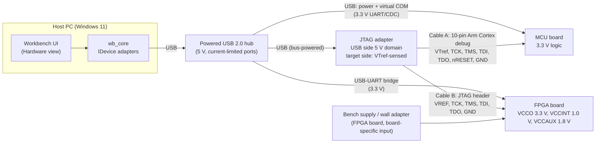

# Embedded-system integration design (Task E)

**Scope.** A host-connected workbench for **one microcontroller board, one FPGA board and one JTAG debug adapter**. This is a *design* plus **SIMULATED** C++ mock adapters. No physical wiring, PCB, firmware deployment or real FPGA programming was done, and nothing in this repository talks to hardware. Part classes ("STM32 Nucleo-class", "Artix-7 board class", "FT2232H / J-Link-class") are *assumptions chosen to make the design concrete*; every number below must be re-checked against the datasheet and schematic of the actual boards before wiring anything.

## 1. Block diagram



ASCII fallback (same content):

```
 +------------------ HOST PC ------------------+
 |  Workbench UI -> wb_core (IDevice adapters)  |
 +----------------------+-----------------------+
                        | USB
              +---------v----------+      (wall adapter / bench PSU)
              | powered USB 2.0 hub|------------------+
              +--+-------+-------+-+                   |
        USB (VCP)|  USB-UART|       |USB (bus powered)  |
          +------v--+  +----v-----+ |                   v
          | MCU     |  | FPGA     | |           (FPGA board supply)
          | 3.3 V   |  | VCCO 3.3 | |
          +----^----+  +----^-----+ |
   Cable A     |  Cable B   |       |
   (10-pin Arm |  (FPGA JTAG|  +----v----------------+
   debug)      |  header)   +--+ JTAG adapter        |
               +---------------+ target side = VTref |
                               +---------------------+
   Only ONE target cable is connected at a time (see Section 4).
```

## 2. Interface and voltage table

| Item | MCU board (3.3 V class) | FPGA board (Artix-7 class) | JTAG adapter (FT2232H / J-Link class) |
|---|---|---|---|
| **Power in** | USB VBUS 5 V from hub, on-board LDO to 3.3 V | Own supply (typ. 5 V barrel or USB, board dependent); on-board regulators make VCCINT 1.0 V, VCCAUX 1.8 V, VCCO 3.3 V | USB bus power 5 V; internal regulator for the chip core |
| **Powers the target?** | No | No | **No.** The adapter only *senses* VTref. It must never back-feed power into a target |
| **I/O voltage domain** | 3.3 V LVCMOS | JTAG pins live in configuration bank 0, powered from that bank's VCCO (assumed 3.3 V) | Adapter-side buffers follow VTref (e.g. 1.8 - 3.3 V); **do not assume 5 V tolerance** |
| **Level shifting** | None needed (3.3 V to 3.3 V). If a board used 1.8 V I/O, a VTref-powered buffer/translator (unidirectional for TCK/TMS/TDI, TDO in the opposite direction) is required | None needed at 3.3 V. Footprint/option for translator if VCCO_0 is 1.8 V | Must be present on the adapter, or added externally, whenever VTref differs from the adapter's native I/O level |
| **Host link** | USB virtual COM port (CDC), e.g. 115200 8N1 for telemetry | USB-UART bridge for logging; configuration only via JTAG | USB 2.0 high speed; host talks MPSSE/vendor protocol |
| **Debug connector** | Arm Cortex 10-pin 1.27 mm (SWD/JTAG), or on-board probe | JTAG header (2.0/2.54 mm) or on-board USB-JTAG; pin numbering is board specific | Cable to target; connector depends on the cable used |
| **Ground** | Common reference via USB and the debug cable GND pins | Common reference via the debug cable GND pins (required even with a separate supply) | GND on every cable; GNDDetect pin on the Arm connector |

### Ground and power rules
1. **One ground reference.** Every device shares ground through the debug cable (several GND pins) and the USB hub. A board with its own power supply is tied to the same ground by the JTAG cable *before* signals are driven; use cables with multiple GND pins.
2. **No ground loops through the supply.** Where the FPGA board uses a wall adapter, power it from the same mains strip/hub as the host if possible; otherwise verify with a meter that there is no significant voltage between the grounds before connecting the JTAG cable.
3. **Hub, not host ports.** A powered hub with per-port current limiting protects the host from a short on one board.
4. **Voltage domains are listed per board and checked, not assumed.** All three are 3.3 V in this design, so no translator is fitted; the design keeps the option because the next board may not be.

## 3. JTAG signal ownership

| Signal | Driven by | Received by | Notes |
|---|---|---|---|
| **TCK** | Adapter | Target | Start at 1 MHz, raise only after reading IDCODE reliably |
| **TMS** | Adapter | Target | Steers the TAP state machine; also SWDIO on Arm SWD (bidirectional there) |
| **TDI** | Adapter | Target | Data into the chain |
| **TDO** | **Target** | Adapter | Only signal the target drives; high-Z when the TAP is not shifting. On the Arm connector the same pin is SWO |
| **TRST_n** | Adapter (optional) | Target | Many targets omit it; TAP reset is done with five TMS=1 clocks instead |
| **nRESET / SRST** | Adapter (open-drain) or target | Both | Treat as open-drain with a pull-up on the target; never push-pull against the target's reset circuit |
| **VTref** | **Target** | Adapter (input only) | The adapter's output level and "target present" detection come from this pin. The adapter must not drive it |
| **GND / GNDDetect** | Common | Common | GNDDetect lets the adapter detect that the cable is plugged in |

Reference: the **Arm Cortex debug connector (10-pin)** is pin 1 VTref, 2 SWDIO/TMS, 3 GND, 4 SWCLK/TCK, 5 GND, 6 SWO/TDO, 7 key, 8 NC/TDI, 9 GNDDetect, 10 nRESET. An **FT2232H**-based adapter typically maps channel A in MPSSE mode as ADBUS0 = TCK, ADBUS1 = TDI, ADBUS2 = TDO, ADBUS3 = TMS. These are the *assumed* device-specific pin assumptions; the FPGA's JTAG pins are dedicated configuration pins (TCK, TMS, TDI, TDO) that cannot be reassigned, and their header pin numbers must be read from the actual board schematic. Do not rely on this document for pin numbers of a specific board.

### Chaining versus separate cables
The two targets are **not** placed in one daisy chain. A chain needs identical voltage, shared TCK/TMS and TDO-to-TDI wiring, and a failure of one board breaks access to the other. Each target gets its own cable, and only **one cable is connected at a time** (manual swap, or a later analog-switch board with break-before-make).

## 4. Why a JTAG adapter is a debug interface, not an interchangeable compute board

- **It has no application to run.** It is a protocol bridge: USB commands from the host are translated into TCK/TMS/TDI timing and TDO sampling for the IEEE 1149.1 test access port. There is no user program, no memory the user owns, no ADC or GPIO application logic.
- **It has no voltage of its own on the target side.** Its outputs are referenced to the target through VTref, so it is meaningless without a powered target. A compute board would define its own I/O voltage.
- **It does not share a connector, voltage or protocol with the boards.** The MCU talks UART/CDC over USB and exposes SWD/JTAG on a 10-pin Arm header; the FPGA exposes dedicated JTAG pins on a different header and is configured through them; the adapter speaks a USB vendor/MPSSE protocol on one side and 1149.1 on the other. Swapping one for another would change connectors, voltage domains and protocols at once, so the workbench models them as three different `DeviceKind` values with different capability sets (the JTAG mock reports `compute: false, runs_user_application: false`).

## 5. Mock adapters (what is implemented)

`src/core/devices.{h,cpp}` implements `IDevice` with `discover()`, `capabilities()`, `connect()`, `disconnect()` and `readTelemetry()` (one JSON message per call) for `mcu0`, `fpga0` and `jtag0`. Everything is labelled **SIMULATED** in names, capability JSON, telemetry JSON, API responses and the UI banner.

- **State machine:** `disconnected -> connected`; a failed connect sets `failed`; `disconnect` returns any state except `disconnected` to `disconnected`; wrong-order calls (telemetry while disconnected, connect twice, disconnect twice) return `invalid_state` (HTTP 409); unknown ids return `not_found` (404).
- **Recoverable failure demo (timeout):** the "Simulate timeout" toggle makes the next 2 connect attempts time out (`timeout`, HTTP 504, `recoverable: true`). The fault then clears. "Connect with retry" retries recoverable failures with exponential backoff (100 ms, 200 ms, 400 ms; max 4 attempts) and recovers on the third attempt; non-recoverable errors are never retried. A single plain "Connect" also recovers on the third click. After a failed retry sequence the device stays `failed` and can be retried or reset with Disconnect.
- **Telemetry:** deterministic, plausible values with a small oscillation (MCU supply and temperature, FPGA VCCINT/VCCAUX/VCCO and die temperature, adapter VTref and TCK). These numbers are invented for the demo and are not measurements.
- **Tests:** `tests/test_devices.cpp` covers discovery, labels, the full state machine, timeout, recovery with the exact backoff sequence, giving up, and non-retry of non-recoverable errors.

## 6. Safe integration plan (for the future physical build)

1. **Paper review.** Collect the three datasheets and the two board schematics; fill in the real voltage, connector and pinout columns; reject any mismatch before touching hardware.
2. **Power off continuity.** Build/inspect each cable with a meter: VTref, TCK, TMS, TDI, TDO, GND are on the correct pins and no signal is shorted to a supply.
3. **Power each board alone**, from a current-limited supply where possible, and measure 3.3 V, 1.8 V and 1.0 V rails against the datasheet before connecting anything else.
4. **Connect the JTAG adapter's USB only**, no target cable. Confirm it enumerates.
5. **Connect cable A (MCU) with the MCU powered.** Verify VTref reads about 3.3 V in the adapter tool; only then allow signals.
6. **Read-only first:** read the IDCODE / device ID at 1 MHz TCK. Increase speed only after repeated clean reads.
7. **Repeat for cable B (FPGA)** after disconnecting cable A.
8. **Only then** allow writes (flash or configuration), after backing up the existing image, one board at a time.
9. **Always:** ESD precautions, never hot-plug target cables while powered unless the connector is rated for it, never connect a 5 V source to a 3.3 V pin, and stop at the first unexpected voltage, temperature or current reading.

## 7. Limitations

- **Everything is simulated.** No USB, serial, JTAG or vendor library is used, so no claim of real hardware behaviour is made. The mock "timeout" is injected, not caused by a real device.
- **Board classes and pinouts are assumptions** and were not checked against real datasheets in this repository; electrical figures must be verified.
- The mock models one telemetry message per request, not streaming, and no flow control, multi-client access, or loss of USB enumeration.
- No real FPGA programming, firmware flashing, PCB, or physical wiring was done (out of scope).
- Retry/backoff is implemented per connect call; there is no background reconnect supervisor.
