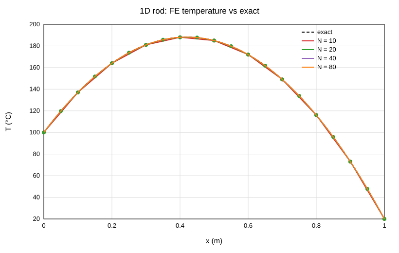
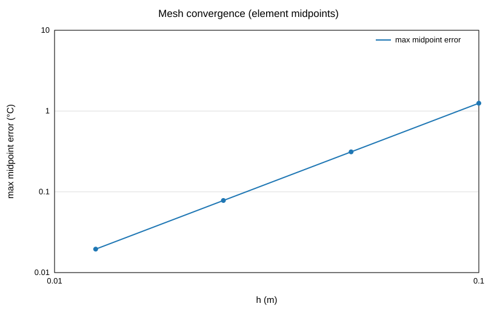
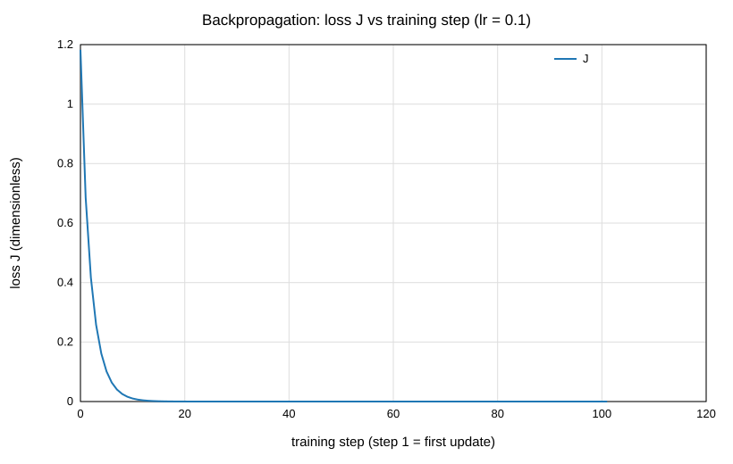
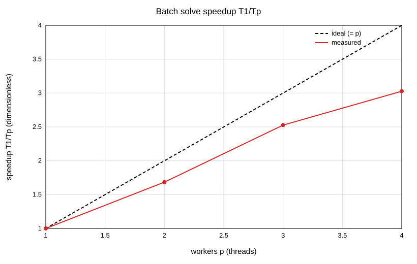

# Unified Engineering Workbench: technical report

Candidate: Magesh (ID: **TODO: Magesh to fill in**). Actual effort: **TODO: Magesh to record hours**. Environment for every number below: Windows 11, Intel Core i5-1135G7 (4 physical / 8 logical cores), 7.73 GiB RAM, g++ 16.2.0 (MSYS2 UCRT64), CMake Release with `-O2`, Ninja. The handwritten backpropagation appendix is separate (scans added by the candidate).

## 1. Design choices

- **One C++17 core, thin transport.** All numerics, parsing, validation and concurrency live in the static library `wb_core` (no HTTP or UI code, built and unit-tested without the server). `Launch.exe` is a GUI-subsystem program that only binds `127.0.0.1` on a free port, serves one static HTML/JS page, converts `wb_core` results to JSON, and opens the default browser. The page (plain JS + vendored Plotly 2.35.2, no CDN) only renders and calls the API. `workbench_cli.exe` regenerates everything in `results/` headlessly.
- **One-click delivery.** Static link (`-static -static-libgcc -static-libstdc++`); `objdump -p` shows only Windows system DLLs (KERNEL32, USER32, SHELL32, WS2_32, api-ms-win-crt-*). Every path is resolved from the executable location. Logging goes to `logs/workbench.log`; the page sends a heartbeat and the process exits 60 s after the last one (measured: 61.6 s idle exit) or on the Quit button.
- **Responsive and safe jobs.** Long work (FEA study, benchmark) runs as a job on its own thread; the page polls `/api/jobs/{id}`; Cancel sets an atomic flag checked between solves; a result is committed once, at the end, so cancelled or failed jobs expose nothing. Files written by the CLI go through temp-file-plus-rename.
- **Validation everywhere.** Each input has a C++ validator with an actionable message ("what is wrong, what to do"); the page repeats the cheap checks for fast feedback but the backend is the authority.

```
 Browser page (static HTML/JS + vendored Plotly)      renders and calls the API only
        | HTTP, JSON, 127.0.0.1 only
 Launch.exe  (src/server: main.cpp, api_compute / api_geometry / api_devices)   transport only
        | direct C++ calls
 wb_core (static lib, no HTTP/UI code):  fea1d, fea_study, backprop, batch, thread_pool, jobs,
        stl_parser, csv_nodes, parse_util, devices (SIMULATED), sysinfo, svg_plot, fileio
 workbench_cli.exe  ->  results/*.csv, *.svg (same wb_core)       wb_tests.exe  ->  ctest
```

## 2. Thermal FEA (Task C)

**Formulation.** -d/dx(kA dT/dx) = qA on [0, L], L = 1 m, A = 1e-4 m², k = 10 W/(m·K), q = 1e4 W/m³, T(0) = 100 °C, T(L) = 20 °C, constant properties, insulated lateral surface. N uniform two-node linear elements, h = L/N. Element stiffness (kA/h)[[1,-1],[-1,1]], consistent load (qAh/2)[1,1], assembled element by element into a symmetric tridiagonal matrix. **Dirichlet conditions by elimination:** the known end temperatures are moved to the right-hand side (K·T_known) and only the N-1 interior unknowns are solved with the Thomas algorithm, which keeps the reduced matrix symmetric positive definite. Exact solution: T(x) = 100 - 80x/L + q/(2k)·x(L-x); maximum 188.2 °C at x = 0.42 m (checked on an N = 100 mesh).

**Verification (`results/fea_convergence.csv`).** The error is measured at element midpoints using the FE interpolant (T_i + T_{i+1})/2, not only at nodes.

| N | h (m) | max nodal error (°C) | max midpoint error (°C) | expected q h²/(8k) | observed order |
|---|---|---|---|---|---|
| 10 | 0.1 | 5.68e-14 | 1.25 | 1.25 | n/a |
| 20 | 0.05 | 2.56e-13 | 0.3125 | 0.3125 | 2.000 |
| 40 | 0.025 | 7.67e-13 | 0.078125 | 0.078125 | 2.000 |
| 80 | 0.0125 | 1.14e-12 | 0.01953125 | 0.01953125 | 2.000 |

Midpoint errors equal q h²/(8k) to better than 1e-6 relative (unit test), i.e. second order, as expected for a linear interpolant of a parabola.



**One real debugging insight.** My first UI plotted the *nodal* error and it looked like a bug: ~1e-13 and *growing* slightly with N (5.7e-14 to 1.1e-12), the opposite of convergence. It is not a bug. For this constant-coefficient 1D problem the linear-element solution is exact at the nodes (a known 1D property), so the nodal "error" is pure round-off that accumulates with more unknowns. The discretisation error lives *between* the nodes, which is why the brief asks for the midpoint error. I replaced that plot with the per-element midpoint error (flat at q h²/(8k) for each mesh) and kept the nodal column in the table only as a round-off check.

**Assumptions and units.** SI units throughout (m, m², W/(m·K), W/m³, °C); k, A, q constant; steady state; 1D conduction; no convection or radiation from the sides; Dirichlet values at both ends.

**Task F (backpropagation).** h = tanh(wx+b), ŷ = vh+c, J = ½(ŷ-y)², x = 1, y = 2, lr = 0.1, start (w,b,v,c) = (0.5, 0, 1, 0). C++ results (hand-derived chain rule, no autodiff): h = 0.4621171573, J = 1.1825418, dJ/dw = dJ/db = -1.2094645, dJ/dv = -0.7106820, dJ/dc = -1.5378828; after one simultaneous update w = 0.6209464, b = 0.1209464, v = 1.0710682, c = 0.1537883. Central differences (ε = 1e-6) agree with all four gradients to about 1e-10 (limit 1e-5). The loss then falls monotonically over the 100 further steps to about 1.7e-20 (`results/backprop_loss.*`). The build plan quoted a few of these values with errors in the 6th-7th digit; I verified the values above with a separate Python calculation and the tests assert them.



## 3. Multicore batch solves (Task D)

**Workload.** 400 independent cases of 2000 elements; k ~ U[1,100], q ~ U[1e3,1e5] from `std::mt19937_64` (seed 42); identical solver in the serial and parallel runners. The pool has p threads that take case indices from a shared atomic counter and write result i into a pre-sized slot i (deterministic order). Timing uses `steady_clock` around the compute call only (1 warm-up + 5 measured repetitions, median); file loading, rendering and compilation are excluded. Launch-to-ready (process start to server listening) is reported separately: 259.7 ms on the first start after a long idle period and 22.5, 22.1, 12.4, 24.1 ms on four further starts.

| mode | workers p | median (ms) | speedup T1/Tp | efficiency | speedup vs serial |
|---|---|---|---|---|---|
| serial | n/a | 12.524 | n/a | n/a | n/a |
| parallel | 1 | 13.332 | 1.000 | 1.000 | 0.939 |
| parallel | 2 | 6.611 | 2.017 | 1.008 | 1.894 |
| parallel | 3 | 4.940 | 2.699 | 0.900 | 2.535 |
| parallel | 4 | 3.831 | 3.480 | 0.870 | 3.269 |

**Agreement:** max |T_serial - T_parallel| over all cases and nodes = 0 °C (limit 1e-8); both runners execute the identical floating-point operations per case, so they are bit-identical.

**Run-to-run variability (`results/perf_repeat.csv`, three independent full runs).** Speedup T1/Tp at p = 2, 3, 4: run 1: 2.017, 2.699, 3.480; run 2: 1.894, 2.692, 3.107; run 3: 1.676, 2.404, 2.951 (efficiency at p = 4: 0.870, 0.777, 0.738). The single table above is therefore one sample, not a stable figure.



**Overhead and limitations (honest analysis).** (1) Each batch lasts only 4-13 ms, so thread start-up (threads are created inside the timed call), scheduler jitter and timer noise are a visible fraction of the time; a one-worker pool is 6 % *slower* than the plain serial loop for this reason. (2) Each solve allocates several vectors, so the allocator is a shared resource and memory traffic grows with p. (3) The CPU is a 15 W laptop part: 4 physical cores with 2-way SMT, and boost clocks fall under all-core load, so efficiency declines from p = 2 to p = 4. (4) Other desktop programs were running during the measurements; I did not isolate the machine, pin threads or fix the clock. (5) Efficiency slightly above 1 at p = 2 is measurement noise in T1, not super-linear scaling. Nothing here supports a claim about other hardware. Parallel work is real (the CPU is used by p threads) and the speedup is not a UI effect.

## 4. Embedded integration design (Task E)

The design (`docs/embedded_design.md`) connects one microcontroller board, one FPGA board and one JTAG adapter to the host through a powered USB hub, with a block diagram, an interface and voltage table, per-signal JTAG ownership (TCK/TMS/TDI/TRST_n driven by the adapter, TDO and VTref by the target; the adapter never drives VTref or powers the target), a single ground reference through the debug cable, and no level shifting because all three domains are assumed 3.3 V (option kept if a board uses 1.8 V). A JTAG adapter is a debug interface, not a compute board: it only translates USB commands into IEEE 1149.1 signalling referenced to the target's VTref, runs no user application, and shares no connector, voltage or protocol with the other two; the workbench models the three as different device kinds (`compute: false` for the adapter). Separate cables, one connected at a time, are used instead of a daisy chain. A staged safe-integration plan (paper review, continuity, rails, VTref check, read-only IDCODE, then writes) is included. **Implemented and tested:** C++ mock adapters (`IDevice`: discover, capabilities, connect, disconnect, one telemetry message) for all three devices, all labelled SIMULATED, with a state machine and a recoverable timeout: the toggle makes the next two connects time out, then retry with backoff (100 ms, 200 ms) recovers on attempt 3 (unit tests and UI test). **Not done:** any physical hardware; the electrical and pinout statements come from general knowledge, were not checked against the actual datasheets, and must be verified before building anything.

## 5. Test outcomes

- **C++ unit tests (doctest, `ctest`):** 50 test cases, 1583 assertions, 0 failures: FEA (midpoint errors, order, BCs, validation), backprop (values, finite-difference check, a deliberately wrong gradient is caught), batch and thread pool (reproducibility, ordering, exactly-once, exceptions, cancellation), parsers (25 malformed fixtures, each with a line-numbered or explanatory message, plus one valid tolerance file), devices (state machine, timeout, recovery), jobs (commit/cancel), file I/O.
- **UI smoke test (headless Edge through DevTools):** 32 of 32 checks pass against the build and against the extracted ZIP (path containing a space): four tabs, STL 12 triangles / 8 vertices, point cloud 1331 nodes with the colourbar "Temperature (°C)", rejected binary STL and duplicate-id CSV, FEA table, cancel and button locking, hardware retry, no console errors, Quit.
- **File-size limits actually tested through the API:** files above 200 MB are refused with a message (201 MB tested). A 184.4 MiB CSV with 9.4 M nodes parsed in 3.1 s and a 186.8 MiB ASCII STL with 1.8 M triangles in 7.7 s (including upload and JSON), with the server process peaking at about 1.0 GiB. Parse-only timings (`results/parse_benchmark.csv`): 200 k triangles 0.30 s, 1 M nodes 0.24 s, 3 M nodes 0.74 s. Large point clouds are decimated to 200,000 points for display only; rendering of very large meshes in the browser was not tested.
- **Launch checks:** the extracted package starts, logs "opened the default browser", answers `/api/health`, exits on Quit, and exits by itself after 60 s without a heartbeat.

## 6. Limitations

- Only ASCII STL and the exact CSV header are supported; the CSV importer was exercised only on synthetic data, never on a real ANSYS export, and `#` comment lines are a documented extension. STL units are assumed to be metres.
- The rod is one-dimensional with constant properties; no convergence study beyond uniform meshes of the given sizes.
- The performance numbers are one machine, one noisy laptop, short batches (see the variability above).
- Not tested on a clean machine or in Windows Sandbox; an unsigned `Launch.exe` may trigger SmartScreen. Only Edge was tested for the UI; mouse rotate/pan/zoom were not simulated.
- Hardware is fully simulated; the embedded design is unverified against real datasheets.
- AI assistance (Claude in VS Code, Sonnet 5.5) wrote most of the first drafts; the log (`docs/ai_log.md`) records prompts, my corrections, the failures that really happened and what remains for the candidate to review.
