# UI walkthrough (automated, timestamped)

Generated by `tests/ui/ui_smoke.mjs` on 2026-11-01T08:52:55.576Z by driving the real page in headless msedge against `Launch.exe`.
Result: **40 checks passed, 0 failed.** Times are UTC. Mouse rotate (drag), zoom (wheel), pan (right-drag) and hover are real input events sent through the DevTools protocol. The node *click* is the one exception: Plotly's 3D click detection does not fire from synthetic input, so the test emits the same `plotly_click` event and checks the page's handler.

- `08:52:36.282` PASS: status bar shows "Backend ready"
- `08:52:36.285` PASS: four tabs present

### Start page: Geometry tab, status bar "Backend ready"
`2026-11-01T08:52:36.935Z`

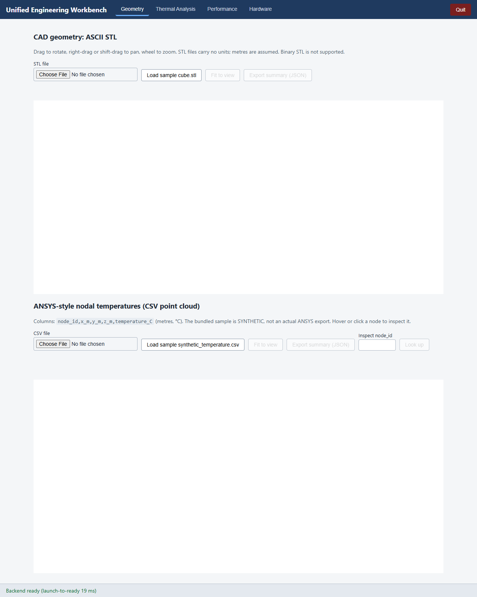

- `08:52:37.987` PASS: STL sample: 12 triangles, 8 vertices
- `08:52:38.002` PASS: STL mesh3d trace drawn
- `08:52:38.003` PASS: Fit to view enabled after load

### STL sample loaded: 12 triangles, statistics, 3D view
`2026-11-01T08:52:39.147Z`

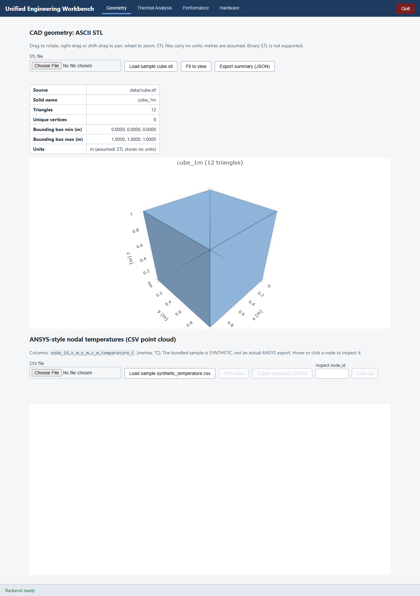

- `08:52:40.110` PASS: mouse drag rotates the STL model (camera eye changed)

### After a real mouse drag: model rotated
`2026-11-01T08:52:40.640Z`

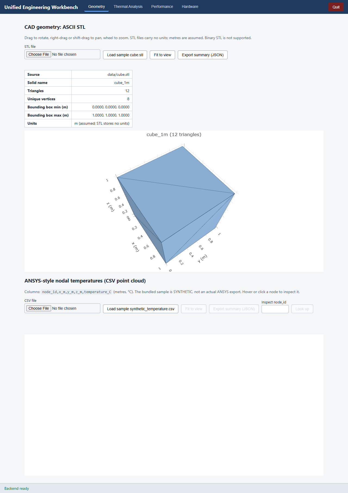

- `08:52:41.388` PASS: mouse wheel zooms (camera distance changed)
- `08:52:42.618` PASS: right-button drag pans (camera centre changed)

### After wheel zoom and right-drag pan
`2026-11-01T08:52:43.170Z`

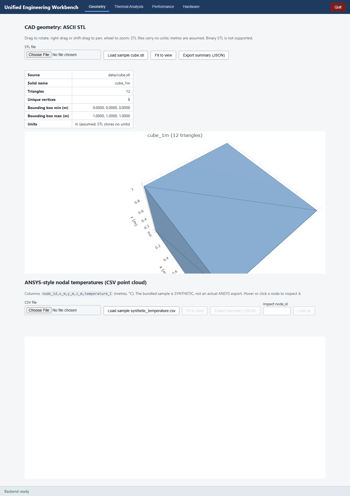

- `08:52:43.895` PASS: Fit to view restores the default camera

### After "Fit to view": default camera restored
`2026-11-01T08:52:44.445Z`


- `08:52:44.938` PASS: CSV sample: 1331 nodes
- `08:52:44.978` PASS: point cloud is scatter3d with colourbar "Temperature (°C)"
- `08:52:45.018` PASS: hover template shows node_id, x, y, z and T
- `08:52:45.215` PASS: node lookup returns node 1
- `08:52:45.937` PASS: hovering a node with the mouse shows a label
- `08:52:45.938` PASS: hover label shows node_id, x, y, z and T

### Point cloud: hover label (node_id, x, y, z, T) shown by a real mouse hover
`2026-11-01T08:52:46.067Z`

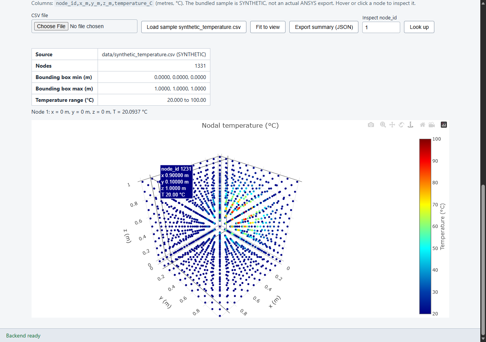

- `08:52:46.077` PASS: click handler shows the selected node details (event emitted programmatically)

### ANSYS-style CSV (synthetic): coloured point cloud, legend, node inspector
`2026-11-01T08:52:46.669Z`

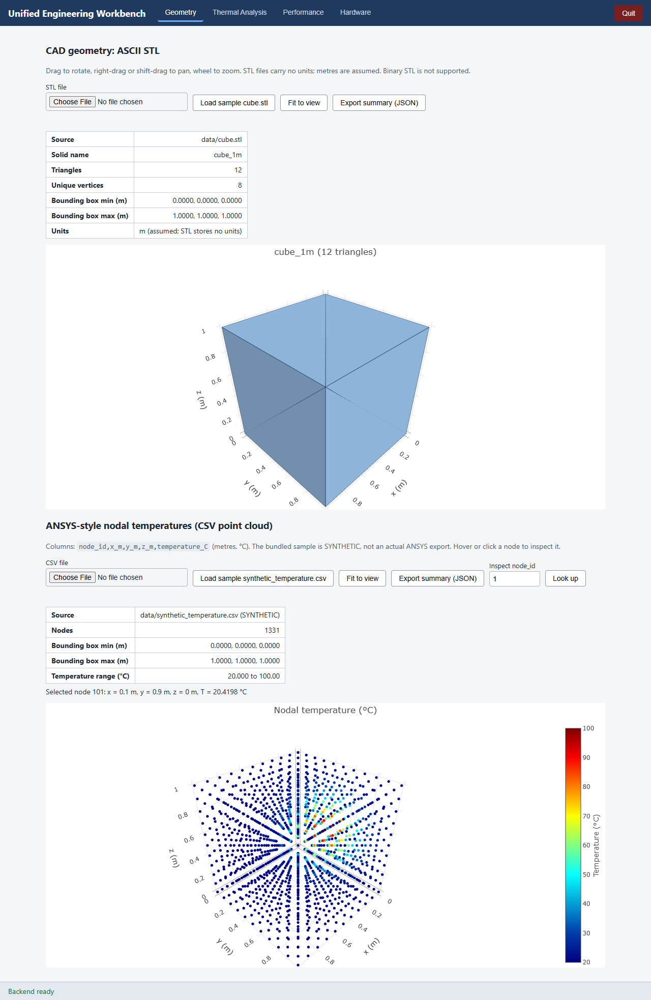

- `08:52:46.804` PASS: binary STL is rejected with an actionable message
- `08:52:46.934` PASS: CSV with duplicate node_id is rejected with its line number

### Malformed files rejected with line numbers and advice (binary STL, duplicate node_id)
`2026-11-01T08:52:47.482Z`

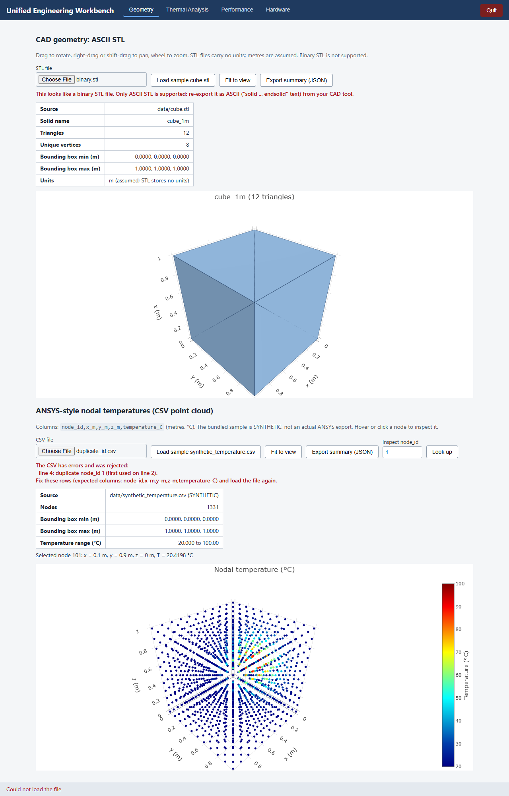

- `08:52:47.638` PASS: invalid k is explained before any request

### Thermal tab: invalid conductivity explained, input highlighted
`2026-11-01T08:52:48.177Z`

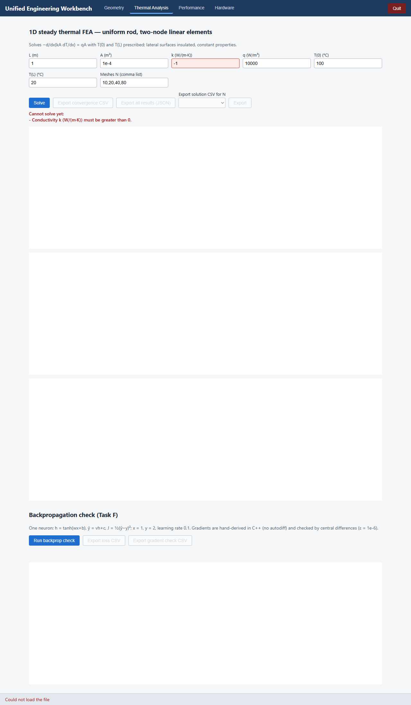

- `08:52:48.341` PASS: convergence table: midpoint errors 1.25, 0.3125, 0.078125, 0.01953125
- `08:52:48.341` PASS: observed order 2.000
- `08:52:48.342` PASS: three FEA plots drawn
- `08:52:48.342` PASS: temperature plot has FE N=10..80 and exact
- `08:52:48.343` PASS: export buttons enabled
- `08:52:48.460` PASS: backprop: 4 gradients pass the finite-difference check
- `08:52:48.461` PASS: backprop: dJ/dw = -1.2094645

### Thermal tab solved: FE vs exact, midpoint error, convergence, backprop panel
`2026-11-01T08:52:49.852Z`

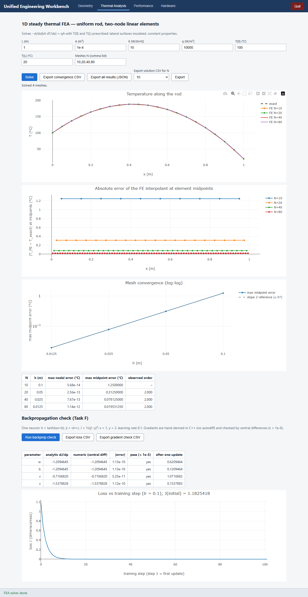

- `08:52:50.227` PASS: performance table lists serial and parallel rows
- `08:52:50.228` PASS: serial/parallel agreement reported as PASS
- `08:52:50.229` PASS: speedup plot drawn

### Performance tab: serial vs parallel table and speedup plot
`2026-11-01T08:52:51.226Z`

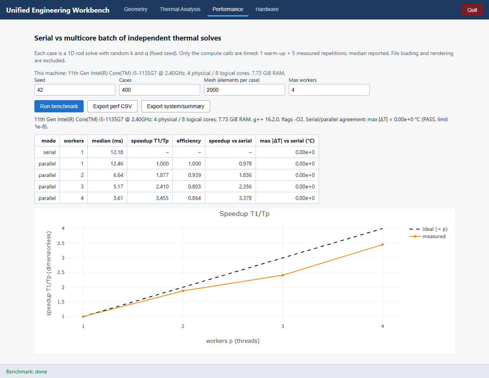

- `08:52:51.339` PASS: run buttons are disabled while a job runs
- `08:52:51.343` PASS: Cancel button is visible during the job

### A long job running: progress in the status bar, Cancel visible, run buttons disabled
`2026-11-01T08:52:51.842Z`

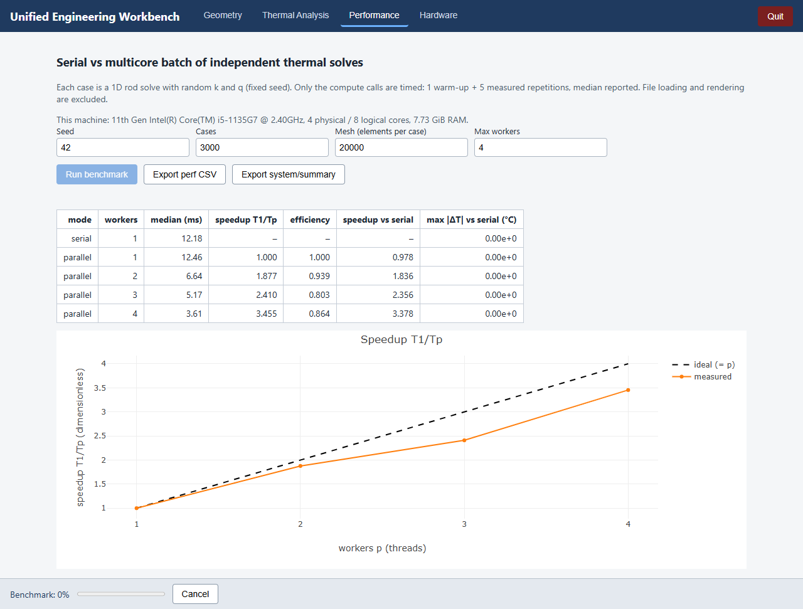

- `08:52:51.965` PASS: cancelled run keeps no results and says so
- `08:52:51.966` PASS: buttons re-enabled after cancel

### After Cancel: "cancelled, no results were kept"
`2026-11-01T08:52:52.465Z`

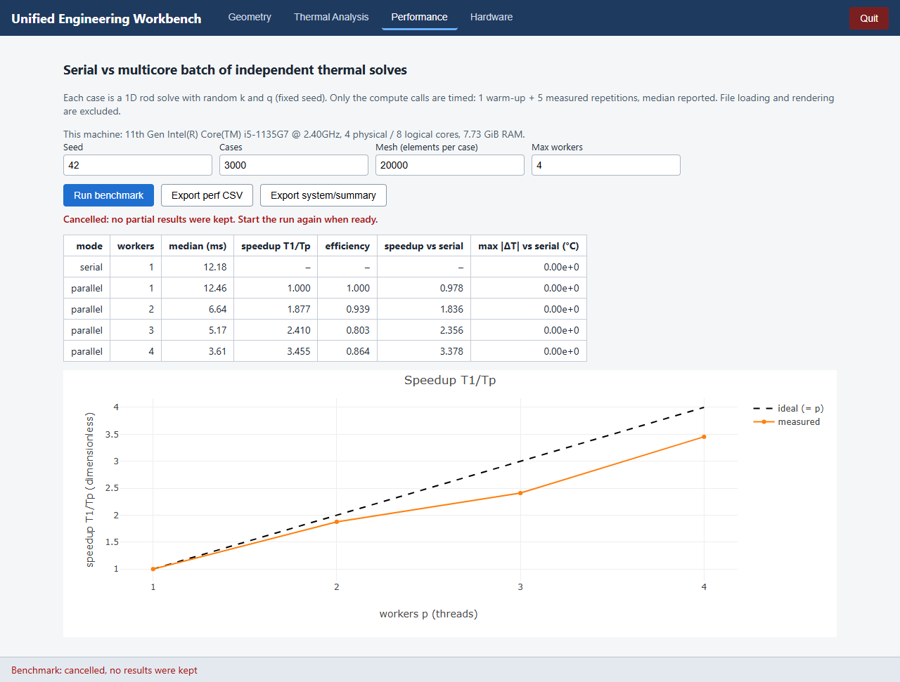

- `08:52:52.485` PASS: 3 devices listed, all badged SIMULATED
- `08:52:52.942` PASS: timeout fault shown, then recovery by retry with backoff
- `08:52:53.067` PASS: telemetry message is labelled SIMULATED
- `08:52:53.184` PASS: JTAG capabilities say it is not a compute board
- `08:52:53.185` PASS: JTAG capabilities explain level translation comes from buffers on VTref

### Hardware tab: SIMULATED devices, injected timeout then recovery by retry with backoff, telemetry, capabilities
`2026-11-01T08:52:54.204Z`

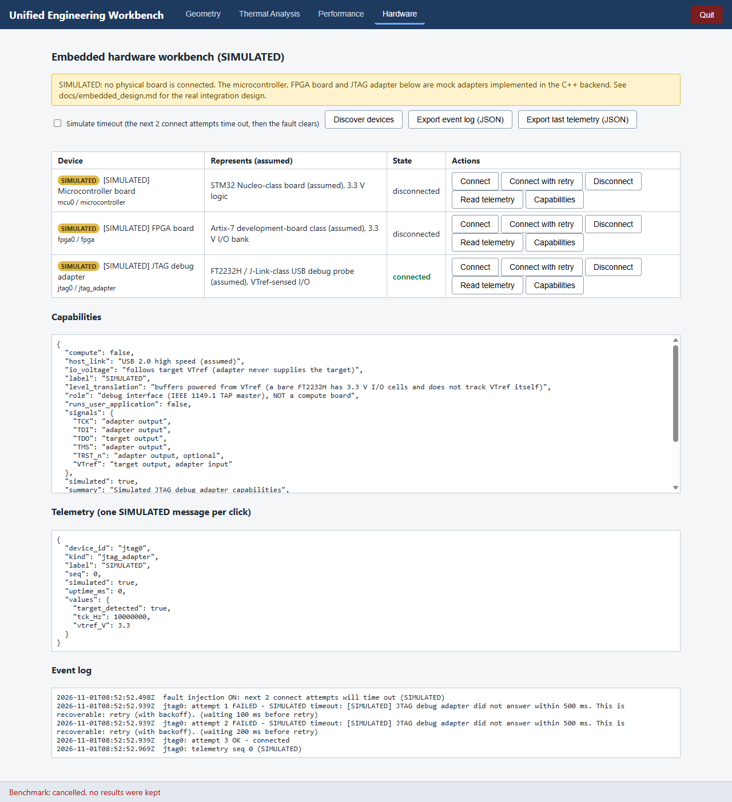

- `08:52:54.204` PASS: no JavaScript errors in the console

### After Quit: the page reports that the workbench stopped
`2026-11-01T08:52:55.055Z`


- `08:52:55.055` PASS: Quit button stops Launch.exe

## Application log (`logs/workbench.log`)

```
starting Launch.exe
listening on 127.0.0.1:55680, launch-to-ready 18.730100 ms
server stopped
```
